<p align="center">
  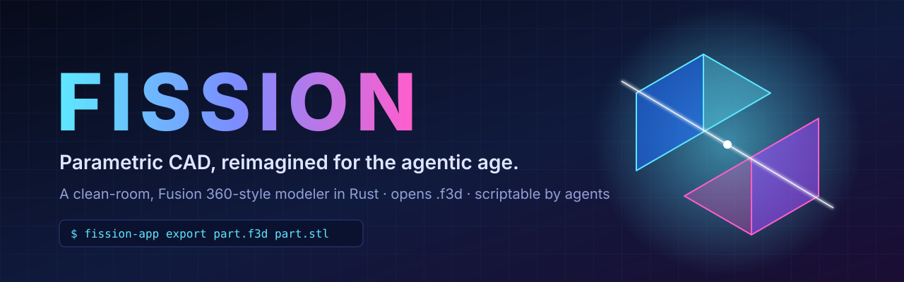
</p>

<p align="center">
  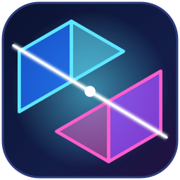
</p>

<p align="center">
  
  
  
  
  
</p>

<p align="center">
  <b>Fission</b> is a clean-room reimplementation of the Fusion 360 workflow, written from scratch in Rust.<br>
  Same muscle memory: toolbar tabs, browser tree, a timeline with a history marker, live-preview dialogs.<br>
  New idea: <b>every part of it is built to be driven by an AI agent as easily as by a human.</b>
</p>

<p align="center">
  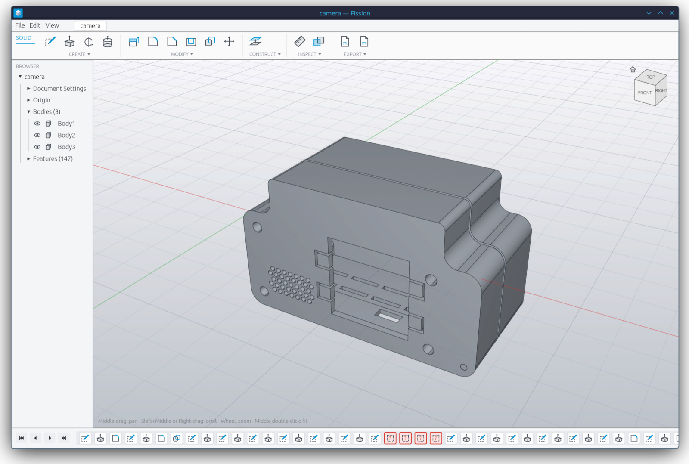
  <br><sub><i>A real Fusion design (.f3d) opened in Fission. All 147 timeline features were read, and 133 of them replay as native parametric features.</i></sub>
</p>

---

## ⚡ Why Fission

Desktop CAD was designed for a person with a mouse. Agents now write code, run tests and ship software, but they still can't use a CAD program in any real way. The model is locked inside a GUI, in a binary file, behind a cloud login. Fission is built the other way around:

| | Traditional CAD | **Fission** |
|---|---|---|
| **Design file** | Opaque binary blob | **Readable [RON](https://github.com/ron-rs/ron) text**: a list of features and parameters that an agent can diff, write and review in a PR |
| **Automation** | A scripting API bolted onto the GUI | **Headless CLI**: `fission-app export design.f3d out.stl` replays the whole timeline without a window |
| **UI state** | Click to get there | **Scriptable states**: `FISSION_DEMO="edit:3,preview"` boots the app into any dialog for screenshot tests |
| **Motion checks** | Drag it in the GUI and look | **`fission-app interfere`** sweeps a joint and gives the exact overlap in mm³ at every step (exit 3 on a collision). **`fission-app animate`** renders the sweep to a GIF or MP4 without a window |
| **Kernel crashes** | Take the app down | **Crash-isolated worker**: the geometry kernel runs in its own process. If it dies, Fission bisects the timeline and marks the one bad feature red |
| **Your data** | Cloud account, subscription | **Local files**. Opens your Fusion `.f3d` designs and exports STL / 3MF / OBJ / STEP |
| **Geometry kernel** | Fixed | **Swappable**. The app only calls a `Kernel` trait. OpenCascade today, pure-Rust (Truck) later |

> **Built with agents, for agents.** Fission was developed largely by an AI coding agent. The agent wrote the code, decoded the `.f3d` file format from sample files, tested the app by driving its real UI over remote HID input, sliced the exported STLs in a slicer, and checked volumes against Fusion's own saved bodies. Every design decision above came out of what that loop needed.

---

## 🌗 Light or dark

<table>
<tr>
<td width="50%"></td>
<td width="50%">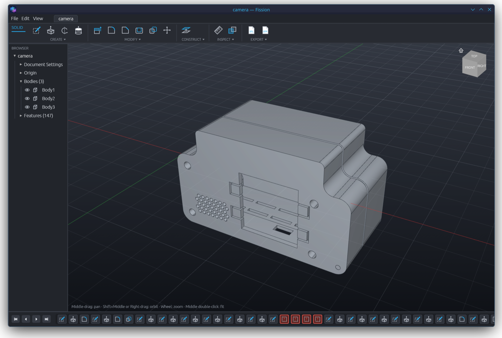</td>
</tr>
<tr>
<td>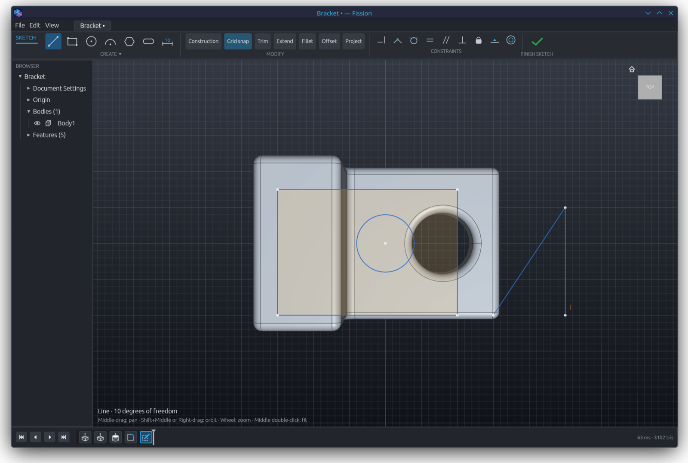</td>
<td>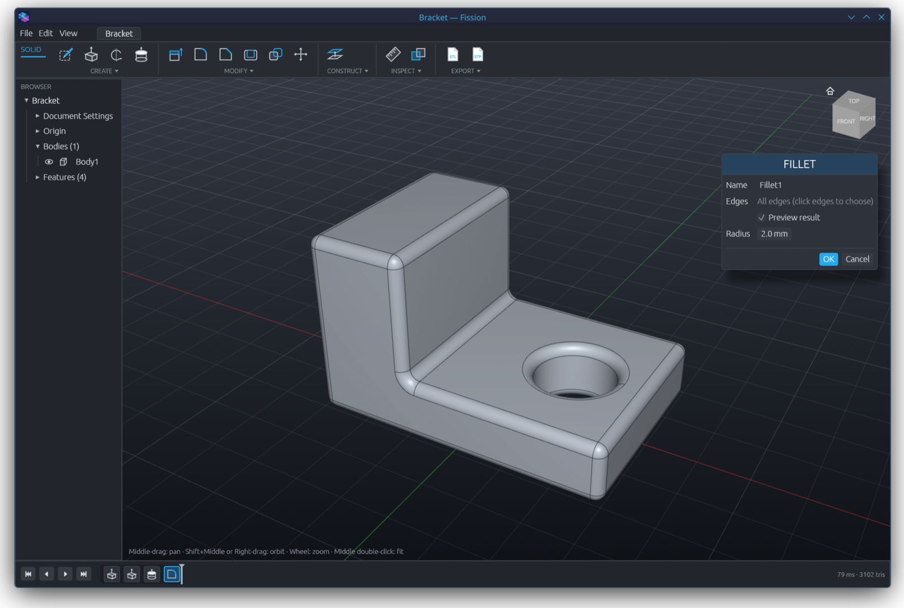</td>
</tr>
</table>

Switch with **View ▸ Dark Mode**. The choice is saved in `~/.config/fission/theme`. Without a saved choice, Fission follows the system theme when the platform reports one. `FISSION_THEME=dark` or `light` overrides both for one run, which is handy for screenshots.

## 🖼️ Tour

<table>
<tr>
<td width="50%">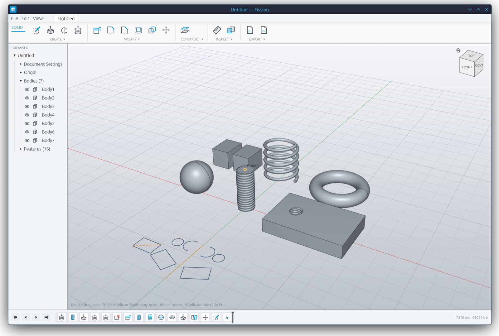<br><b>Real geometry, not toys.</b> Modeled ISO threads, coils, spheres, tori, split bodies, offset and deleted faces, and a sketch drawn with 3-point rectangles, arcs and Mirror.</td>
<td width="50%">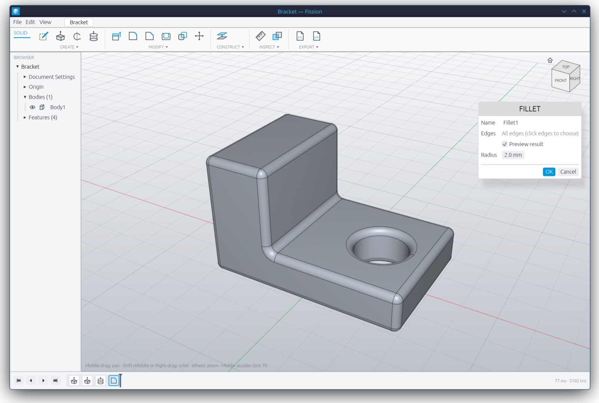<br><b>Live-preview dialogs.</b> Edit any timeline feature and watch the model rebuild as you type. A typical rebuild takes about 50 ms.</td>
</tr>
<tr>
<td>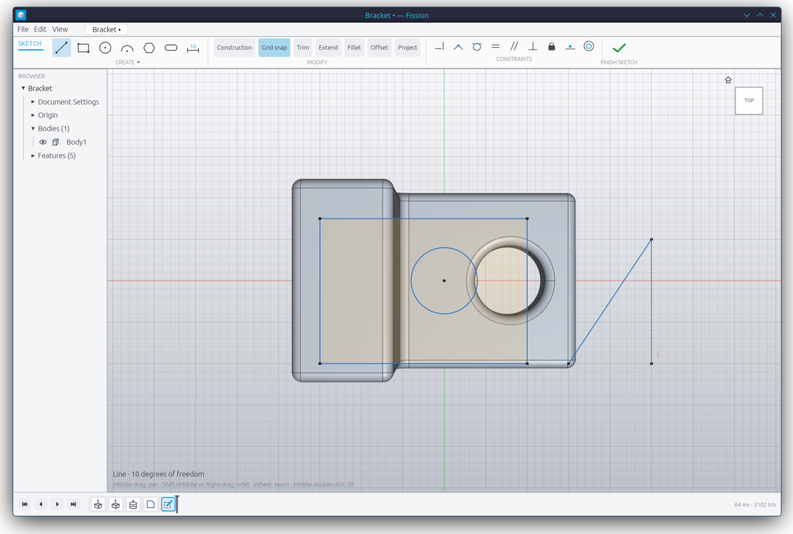<br><b>Constraint sketching.</b> A Levenberg–Marquardt solver, snapping, dimensions, and trim / extend / offset / fillet / project / mirror. Closed regions become profiles automatically.</td>
<td>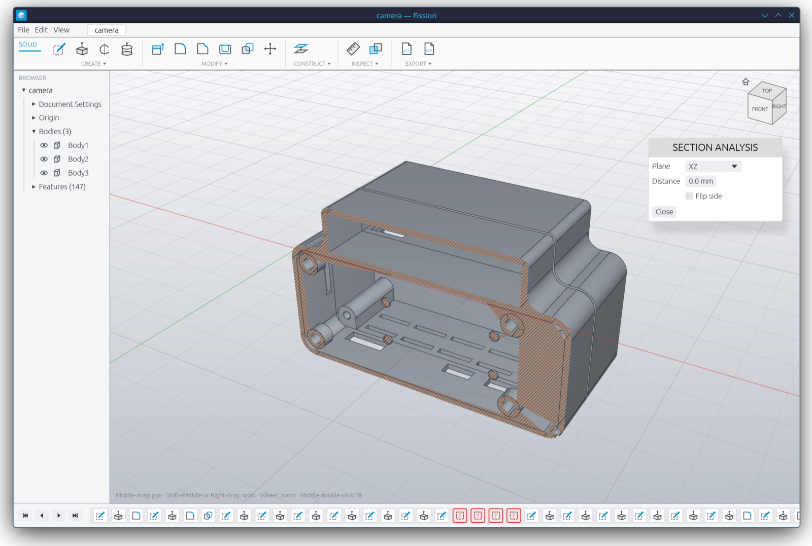<br><b>Section analysis.</b> Cut the view on any plane. Cut solids get hatched caps, and picking ignores the part that's cut away.</td>
</tr>
<tr>
<td>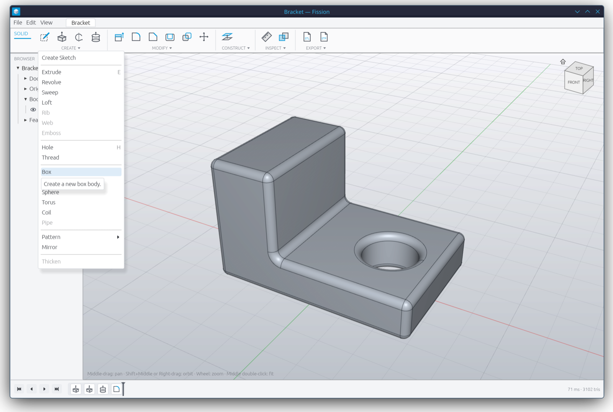<br><b>Familiar layout.</b> SOLID / SKETCH tabs and CREATE · MODIFY · CONSTRUCT · INSPECT · EXPORT panels, with Fusion's hotkeys (<code>E</code>, <code>Q</code>, <code>F</code>, <code>H</code>, <code>L</code>, <code>R</code>, <code>C</code>, <code>D</code>, <code>T</code>, <code>O</code>, <code>P</code>…).</td>
<td>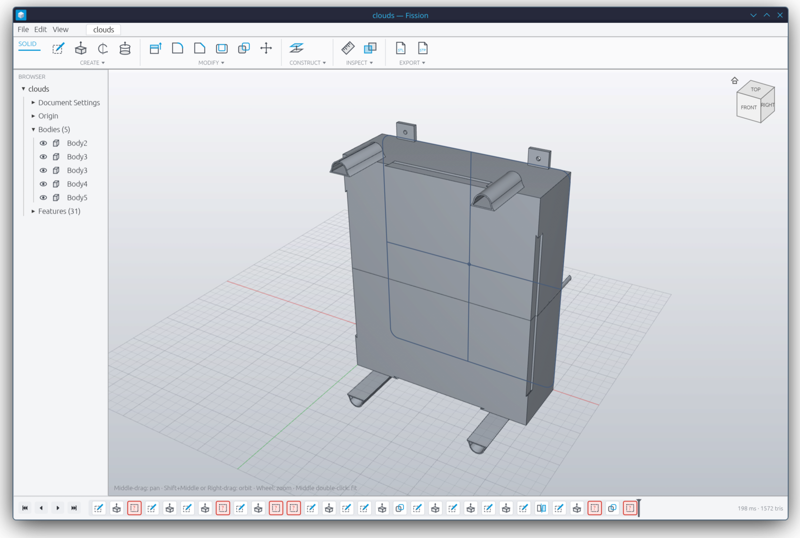<br><b>Your Fusion library, freed.</b> <code>.f3d</code> files open with their sketches, extrudes, fillets, combines, splits and user parameters, as editable features.</td>
</tr>
<tr>
<td colspan="2" align="center">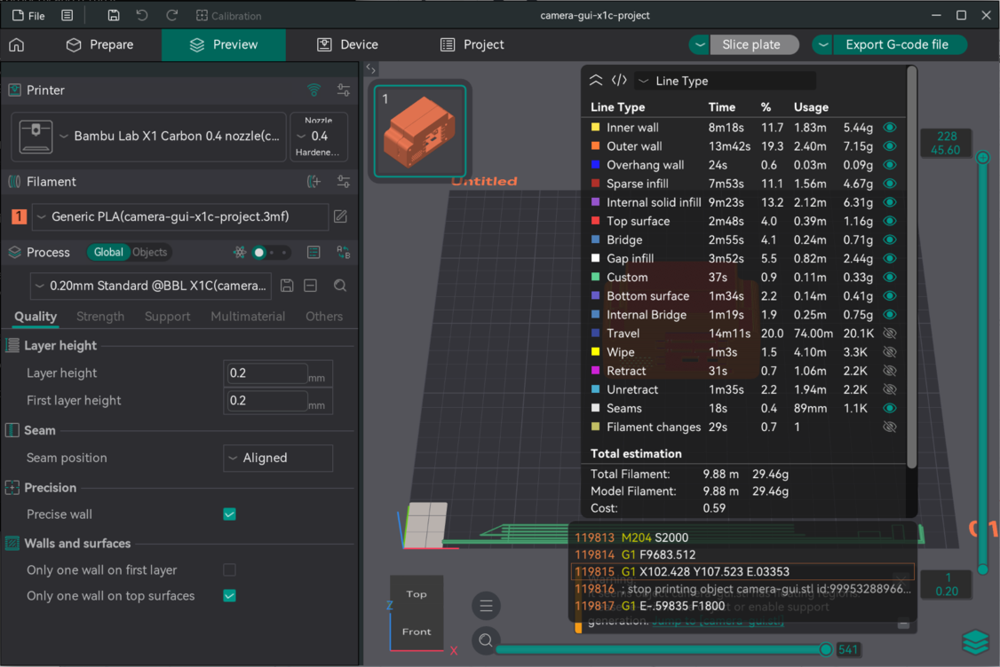<br><b>Straight to the printer.</b> The camera housing exported from Fission with the CLI, sliced in OrcaSlicer for a Bambu X1C: 228 layers, 29 g of PLA, about 1 h 11 min. Exported meshes are watertight, threads included.</td>
</tr>
</table>

---

## 🚀 Quick start

```sh
git clone <this repo> fission && cd fission
cargo run --release -p fission-app                    # opens the sample "Bracket"
cargo run --release -p fission-app -- part.fission    # open a saved design
cargo run --release -p fission-app -- design.f3d      # open a Fusion design
```

> The first build compiles a bundled OpenCascade 7.8.1, which takes about 30 minutes. Builds after that take seconds. Always use `--release`, or OCCT gets compiled a second time for debug. You need CMake and a C++ toolchain.

### 🤖 Headless, for agents and CI

```sh
fission-app export --sample           out/bracket.stl
fission-app export part.fission       out/part.step
fission-app export design.f3d         out/design.3mf    # replays the .f3d timeline, no window
```

Exit codes are `0` for OK, `1` for failure, and `3` when the file exported but some features had errors. The errors are listed on stderr, so an agent can tell which feature broke.

Joints can be swept without a window, too:

```sh
fission-app interfere case.fission --joint Hinge --from -180 --to 12 --steps 33   # exit 3 on a collision
fission-app interfere case.fission --json                                         # machine-readable
fission-app animate   case.fission --joint Hinge --frames 30 --pingpong --out hinge.gif
fission-app animate   case.fission --view front --size 1280x720 --dark --out frames/  # PNG sequence
```

See [Joints, motion and animation](#-joints-motion-and-animation) for what they print.

A design file is plain text that an agent can write directly:

```ron
(
    name: "Bracket",
    features: [
        (name: "Extrude1", suppressed: false, target: None, kind: Extrude(
            sketch: Rect(plane: XY, offset: 0.0, center: (0.0, 0.0), size: (60.0, 40.0)),
            distance: 12.0, symmetric: false, operation: NewBody)),
        (name: "Fillet1", suppressed: false, target: None, kind: Fillet(radius: 2.0, edges: [])),
    ],
    marker: 2,
)
```

Screenshot any UI state without touching the mouse:

```sh
tools/snap.sh out/fillet.png "edit:3,preview"          # open a feature dialog with its preview
tools/snap.sh out/menu.png   "menu:create"             # open a dropdown
tools/snap.sh out/sec.png    "cmd:section analysis" design.f3d
tools/snap.sh out/hinge.png  "joint:Hinge=-100"       case.fission   # a joint previewed at a value
```

The step grammar is documented on `FissionApp::run_demo`.

---

## 🦾 Joints, motion and animation

<p align="center">
  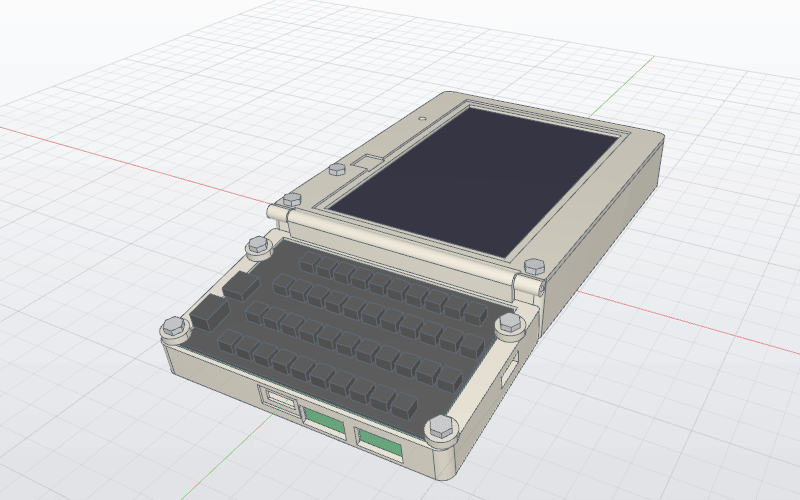
</p>
<p align="center"><sub>A handheld case's keyboard flap on a revolute joint, -180° to +10°. Rendered by <code>fission-app animate</code> in about 8 s, with no window.</sub></p>

**ASSEMBLE ▸ Joint** (`J`) lets the selected bodies hinge about an axis (an origin axis, a sketch line or a construction axis) or slide along it, between a minimum and a maximum. Each joint gets a slider in the browser:

- **Scrub.** Dragging the slider swings the bodies live. Their display meshes move rigidly, with no rebuild, so it stays smooth on big designs, and the camera stays put. Releasing keeps the value, as one undoable step.
- **Play.** Swings the joint back and forth between its limits.
- **Parametric.** When the value is tied to a user parameter, scrubbing changes the parameter, so the design stays parametric.

### 🎬 Animation, headless

`fission-app animate` renders a joint sweep through the same wgpu renderer the viewport uses, but offscreen. It makes no window and takes no screenshots, so it runs in CI or over SSH on any machine with a GPU:

```sh
fission-app animate case.fission --joint Hinge --from 10 --to -180 --frames 30 --pingpong --out hinge.gif
fission-app animate case.fission --view front --size 1280x720 --fps 24 --out hinge.mp4
fission-app animate case.fission --dark --out frames/          # a PNG per frame
```

- One camera frames the bodies over the **whole** sweep, so the zoom never jumps between frames.
- Views: `home`, `front`, `back`, `top`, `bottom`, `left`, `right`. Add `--dark` for the dark theme.
- `--pingpong` adds the return leg. GIF (with a per-file palette) and MP4 are encoded with `ffmpeg`. Give a directory instead to get the raw frames.

### 💥 Interference

**INSPECT ▸ Interference** sweeps every joint through its limits and reports the first collision. The same check runs headless, so an agent can tune a hinge stop and know right away whether the lid still closes:

```console
$ fission-app interfere case.fission --joint Hinge --from 8 --to 12 --steps 5
Hinge (revolute, limits -180 to 10 deg, built at 0): 5 steps from 8 to 12
      8.000 deg  clear       0.00 mm3
      9.000 deg  clear       0.00 mm3
     10.000 deg  clear       0.00 mm3
     11.000 deg  HIT       245.26 mm3  Keyboard flap x Body shell 245.26
     12.000 deg  HIT       512.64 mm3  Keyboard flap x Body shell 512.64
clear from 8 to 10 deg
```

It regenerates once, then moves the joint's bodies rigidly and intersects them with every other body in the kernel (with a bounding-box prefilter). The result is exact B-rep volumes, not mesh estimates, and a 25-step sweep of a 150-feature design takes about 6 s. Add `--json` for machine-readable output. The exit code is `3` when anything collides.

A joint in the design file:

```ron
(name: "Hinge", suppressed: false, target: None, kind: Joint(
    bodies: [51, 101], motion: Revolute,
    axis: Line(feature: 156, origin: (0.0, -33.0, 18.9), dir: (1.0, 0.0, 0.0)),
    value: 0.0, min: -180.0, max: 10.0)),
```

---

## 🔬 Opening Fusion `.f3d` files

Fission reads `.f3d` archives on two levels:

1. **Exact B-rep.** The `Breps.BlobParts/*.smb` blobs are ShapeManager binary B-reps, a typed tag stream related to ACIS SAB. `fission-f3d` decodes the full topology (body → lump → shell → face → loop → coedge → edge → vertex) and the geometry: analytic surfaces, NURBS `intcurve`s, and extruded spline surfaces. The OCCT shim then builds faces with shared edges, sews them and heals them into solids.
2. **The parametric timeline.** `Design1/MetaStream.dat` and `BulkStream.dat` hold the feature graph. Fission decodes its sketches (points, lines, arcs, circles, constraints), extrudes (new body / join / cut / intersect), revolves, fillets and chamfers (resolved to edges by geometry), combines, split bodies, construction planes and user parameters. It then **replays them as native Fission features**, so the result is editable and not a dead mesh.

Each replay is checked against the B-rep Fusion saved in the same file (`cargo run --release -p fission-occt --example f3d_check -- file.f3d`):

| Design | Features | Replayed | Fission volume | Fusion volume |
|---|---:|---:|---:|---:|
| Camera housing | 147 | 133 | 25,416 mm³ | 24,981 mm³ |

Features that can't be replayed yet are skipped and marked red in the timeline, with the reason. The model still builds from everything else.

---

## 🧱 Architecture

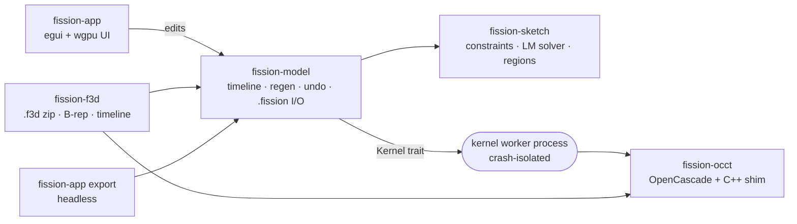

| Crate | What it does |
|---|---|
| `fission-kernel` | The `Kernel` trait, planes, profiles, meshes, edge and face references, STL writer (pure Rust) |
| `fission-occt` | OpenCascade backend plus a C++ shim for healing, validity checks, safe booleans and f3d B-rep building |
| `fission-sketch` | 2D sketches: constraints, Levenberg–Marquardt solver, profile detection, trim / offset / fillet (pure Rust) |
| `fission-model` | Document, feature timeline, regeneration, typed expressions and parameters, undo, `.fission` I/O, f3d replay |
| `fission-f3d` | Fusion `.f3d` reader: zip (including zstd), ShapeManager B-rep decoding, timeline decoding (pure Rust) |
| `fission-app` | egui + wgpu app, kernel worker process, headless CLI export |
| `kernel-lab` | Scratch experiments against the real kernel |

**Design notes**

- **Exact picking.** Every tessellated triangle carries its B-rep face id. The viewport ray-casts those triangles, so hovering highlights the exact face, with no guessing from the depth buffer.
- **Failures never crash.** OCCT's C++ exceptions are caught in the shim, inputs are validated, and results are checked with `BRepCheck` and healed with `ShapeFix`. OCCT also *segfaults* on some valid input, so the kernel runs out-of-process: the app restarts it and isolates the culprit feature.
- **Stable references.** Picked edges and faces are stored as geometry (a point plus a direction), and they re-resolve after every rebuild. They follow upstream edits and report "lost" instead of picking the wrong thing. Inserting, deleting and reordering features remaps every reference.
- **Booleans merge coplanar faces**, as Fusion's do. Otherwise fillets fail on seam edges.

---

## 🧼 Clean room

Fission contains **no Autodesk code, icons, assets or text**. The UI was rebuilt from scratch with its own labels, icons and tooltips, and it follows the familiar Fusion layout and hotkeys so your muscle memory still works. The `.f3d` support is an interoperability reader. It was written by studying the structure of `.f3d` files as data, so you can open designs you made, and it ships no Autodesk software or libraries. The class identifiers it matches on are format identifiers stored in the files themselves.

*Fusion 360 and Autodesk are trademarks of Autodesk, Inc. Fission is an independent project and is not affiliated with or endorsed by Autodesk.*

---

## ✅ Tests

```sh
cargo test --release --workspace --exclude opencascade
```

There are 139 tests. They cover the sketch solver and every sketch tool, typed-value expressions, timeline semantics on a fake kernel (rollback, suppress, errors, undo, save/load, reference remapping), construction geometry, and real OCCT geometry: fillets, shells, drafts, holes, threads (checked watertight), coils, splits, exact areas and volumes, STEP round trips. Tests that decode and replay real `.f3d` files run when samples are present. Put them in `$FISSION_SAMPLES` (`flathex.f3d`, `clouds.f3d`, `camera.f3d`), or `out/f3d`.

`tools/stl/check_stl.py` checks that an exported mesh is printable: closed, consistently oriented, with its volume and bounding box. `tools/stl/flatten_orca.py` resolves OrcaSlicer preset inheritance so the slicer CLI can run in CI.

---

## 🗺️ Status and roadmap

Fission is young and moving fast. What's next:

- **f3d:** extrudes from model faces and Shell (these need face naming), feature patterns, threads, drafts, chamfers, and component transforms and body visibility.
- **Sketch:** splines; projected edges that follow the model.
- **Modeling:** loft and sweep rails and twist, rib / web, thicken, split face, cosmetic threads, materials, components and joint chains (joints that move other joints), contact sets, drawings.
- **Kernel:** a pure-Rust backend behind the same `Kernel` trait.
- **Agents:** an MCP / JSON-RPC surface over the timeline, so an agent can add features, query faces and measure without the UI at all.

Known limits: OCCT 7.8.1 still crashes on some inputs. The app survives, but that feature is skipped (put threads last). System OCCT 7.9 doesn't work with these bindings, so the bundled 7.8.1 is used.

---

## 📖 Manual

<details>
<summary><b>Full command reference</b> (click to expand)</summary>

| | |
|---|---|
| Orbit | Shift + middle-drag, or right-drag |
| Pan | Middle-drag |
| Zoom | Wheel, toward the cursor |
| Fit | Middle double-click, F6, or View ▸ Fit All |
| Standard views | Click a view cube face; the house icon is Home |
| Select a face | Left-click (Esc clears it). The status bar shows the face, point and normal |

Commands (hotkeys follow Fusion):

- **CREATE**: Create Sketch, Extrude `E`, Revolve, Hole `H`; the dropdown adds
  Sweep, Loft, Box, Cylinder, Sphere, Torus, Mirror, and Pattern ▸
  Rectangular/Circular, Coil, and Thread. Sphere, Torus and Coil sit at the
  origin, or on the selected face where you clicked it (joining that body).
  Thread cuts a modeled ISO metric thread into a cylindrical face: outside a
  shaft, inside a hole. The size (M10x1.5) is picked from the face's diameter
  (a hole's is taken as the tap drill); change the size, pitch or hand in the
  dialog, or click another round face.
  Hole drills where you clicked the selected face (click another face while
  its dialog is open to move it): simple, counterbore or countersink, to a
  depth with an optional 118° drill point, or through all.
  Loft starts with every unused single-profile sketch, in timeline order
  (click profiles to add/remove). Sweep takes the newest profile and a path
  sketch's chain (click any sketch line/arc to change it); the profile stays
  square to the path and is mitred at sharp corners. Extrude and
  Revolve use the newest unused sketch's profiles (click regions to pick), or
  otherwise a rectangle on the selected planar face. Revolve turns about a
  sketch line (a construction line by default) or an origin axis.
- **Type values while a command is active**, as in Fusion: start typing a
  number (`25`, `1 in`, `10+5`, `(20-4)/2`) and a value box appears at the
  cursor; Enter applies it and accepts the feature. Lengths take mm/cm/m/in/ft,
  angles deg/rad.
- **MODIFY**: Press Pull `Q` (faces move, edges get a fillet, otherwise it
  extrudes), Fillet `F`, Chamfer, Shell, Draft (lean the picked faces in
  from a pull plane by an angle), Scale, Combine, Offset Face (move faces
  along their normals; the faces around them stretch, so a hole's wall
  shrinks the hole. A flat face whose neighbours aren't straight walls, e.g.
  ringed by fillets, may come out as an extrusion on the face instead, when
  OCCT's offset gives a wrong result), Split Body (cut a body in two along an origin plane or
  a clicked planar face: the first click picks the body, later ones the
  face), Move/Copy `M`, and Delete (remove faces and heal: holes fill in,
  fillets go sharp; a round that can't go alone takes its whole tangent
  chain with it; also under Simplify ▸ Remove Faces). Select edges,
  faces or bodies first, or click them while the dialog is open. The dialog
  then shows the model *before* the feature so you can pick on it; tick
  **Preview result** to see the outcome.
- **CONSTRUCT**: Offset Plane (from the selected face, or XY), Plane at
  Angle (hinged on the selected straight edge, or XY's X axis; type the
  angle), Midplane (between two selected parallel faces). Sketches can
  start on any of them from the plane picker. Also Tangent Plane (at the
  click on a round face), Plane Through Two Edges, and Plane Through Three
  Points. Axes: Through Cylinder (a round face or circular edge), Through
  Edge, Through Two Planes, Through Two Points, Perpendicular at Point (square
  to a face at the click); Revolve, Move and Circular Pattern can turn about
  them. Points: at Vertex, Through Two Edges, Through Three Planes, at Center
  of a circular edge, at Edge and Plane. A "point" pick is an edge selected
  near the end you mean, since vertices aren't picked on their own.
- **INSPECT**: Measure. Click one edge for its length, one face for its exact
  area plus the body's volume and surface area, or two faces/edges for
  distance, ΔX/ΔY/ΔZ, angle and (parallel faces) face-to-face distance.
  Section Analysis cuts the view on an origin plane at a distance (flip to
  keep the other side) and fills the cut solids with a hatched cap; picking
  ignores what's cut away.
- **ASSEMBLE**: Joint `J`. Pick the moving bodies (none means the last body),
  Revolute or Slider, the axis, and Minimum / Maximum / Value. Drag a joint's
  browser slider to try the motion, or press Play. Interference (also under
  INSPECT) sweeps every joint through its limits and names the first pair
  that collides.
- **View ▸ Dark Mode** switches the whole UI and viewport between light and dark (remembered between runs).
- **Appearance** (`A`, MODIFY ▸ Appearance, or right-click a body in the
  browser): finish swatches or a custom color for the selected bodies.
- **Parameters** (MODIFY ▸ Change Parameters): named values like
  `width = 40 mm`, `wall = width / 20` (any order, cycles reported). Use a
  name in any value box (`width / 4` while extruding) or sketch dimension;
  the value then follows the parameter (shown as `fx:`). Typing a plain
  number or dragging the field unlinks it.
- **EXPORT**: STL (visible bodies merged into one mesh), 3MF (for slicers:
  millimetres, one object per body), OBJ, STEP (exact B-rep).
- **File ▸ Import STEP / F3D…** adds a STEP file or a Fusion 360 `.f3d` as a
  timeline feature; **Open** (or `fission-app design.f3d`) starts a new design
  from one. The import's parts (the `.f3d`'s bodies, a STEP assembly's solids)
  are listed under the body with eye toggles; select a face and press `V` to
  hide its part.
- The view cube orbits when dragged and snaps to a view when clicked.
- Click a panel caption (`CREATE ▾`) to open the full dropdown. It follows
  Fusion's order; greyed-out entries are planned.

**Sketching** (the SKETCH tab appears while editing a sketch):

- Create Sketch on a selected planar face (slanted faces too), or click one
  of the origin planes it offers. The view turns to face the sketch plane, and
  the grid moves onto it.
- Line `L` (click points, chains; click the start point to close), Rectangle
  `R` (also 3-Point, at any angle, and Center), Circle `C` (also 2-Point
  across a diameter and 3-Point), Arc (3-Point: start, end, a point on it;
  or Center Point: center, start, end), Polygon (center, then a
  vertex; the side count is in the toolbar while it's active), Slot (two centers, then the
  width), Dimension `D` (click a line for
  its length, a circle for its diameter, or two points for their distance;
  type the value and press Enter). Typing while drawing sets the size: a
  line's length, a circle's diameter, a rectangle's `W,H`, a polygon's radius, a slot's width.
- Snapping: endpoints, the origin, midpoints and curves snap (and get the
  matching constraint), lines snap horizontal/vertical to their start, and
  the grid snaps when **Grid snap** is on. A glyph shows what the click will
  hit.
- MODIFY: Trim `T` (the red piece goes), Extend (click near a free end of a
  line or arc: it grows to the next curve in the way, shown dashed), Fillet (click a corner where two
  lines meet, then type the radius), Offset `O` (click a curve: its whole
  chain is copied at the typed distance; negative goes inside), Project `P`
  (click model edges: lines, circles and arcs are copied in fixed, other
  curves as short lines; projected edges that meet share their points, so
  they make profiles), Mirror (click curves, Enter, then click the mirror
  line; the copies are tied to the originals with Symmetric constraints, so
  they follow edits). The CREATE caption opens the full list. The status
  line says what the active tool wants next.
- CONSTRAINTS: horizontal/vertical, coincident (point–point, or point on a
  line or circle), tangent, equal, parallel, perpendicular, fix, midpoint,
  concentric (and symmetric, from Mirror). These act on the current selection (Select tool; Shift adds).
  Drag points in Select to move them under the constraints.
- Ctrl+Z / Ctrl+Y undo and redo inside the sketch, one curve at a time.
- `X` toggles construction geometry, `Del` deletes, Esc backs out one step,
  and Finish Sketch (the green check, or Ctrl+Enter) returns to SOLID. The
  status line shows remaining degrees of freedom; "Fully constrained" turns
  the curves black, as in Fusion.
- Closed regions become profiles automatically. Nested loops become holes,
  so a circle inside a rectangle gives the plate-with-hole and the disk.

Timeline: double-click a chip to edit it, or right-click for Edit, Suppress,
Roll History Marker Here, Move Earlier/Later and Delete. Drag the dark marker
to roll the model back. A chip turns red when its feature fails; the model
keeps everything before it, and the dialog says why.

Other keys: Ctrl+Z / Ctrl+Y (or Ctrl+Shift+Z), Ctrl+S / Ctrl+Shift+S, Ctrl+O,
Ctrl+N, Enter = OK, Esc = Cancel, Del = delete the selected feature.

Designs save as `.fission` files: readable RON listing the features and their
parameters.

</details>

---

<p align="center"><sub>Made with Rust, OpenCascade and a lot of agent hours. Built so that agents and humans can design together.</sub></p>
